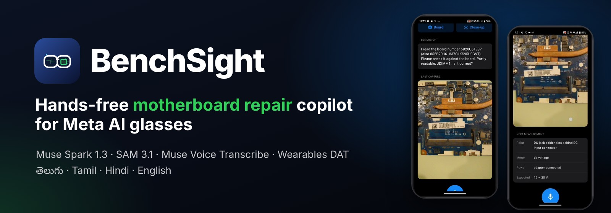
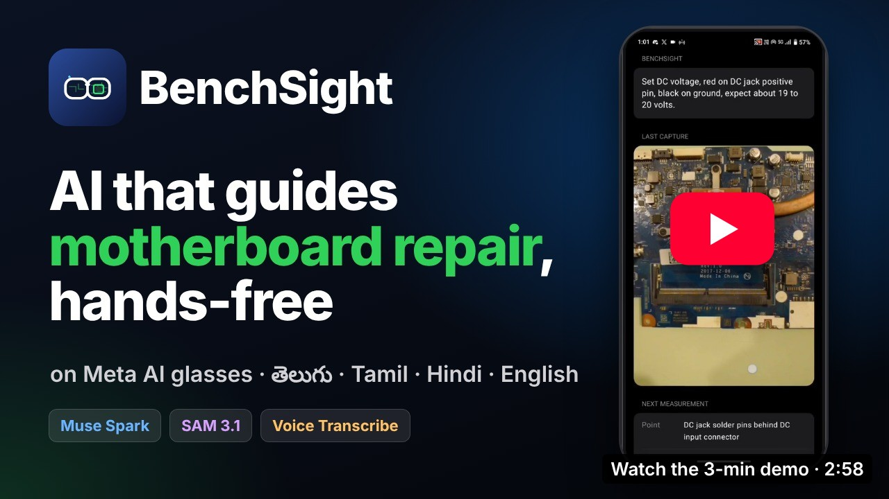
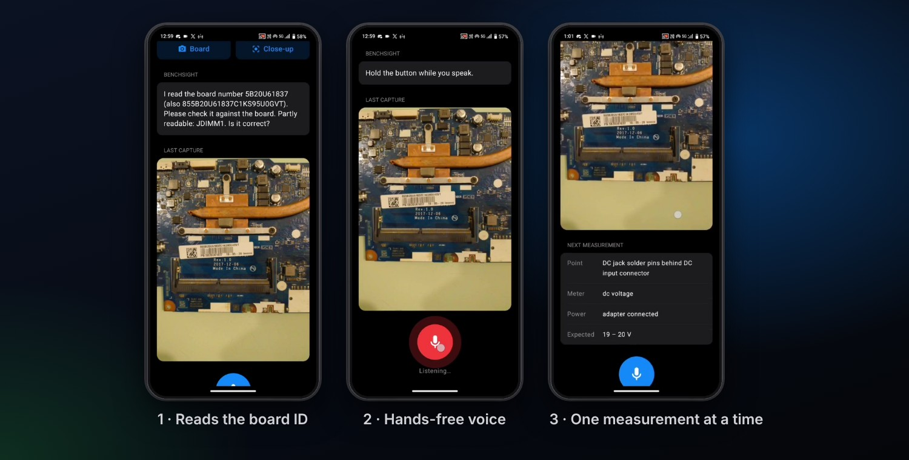
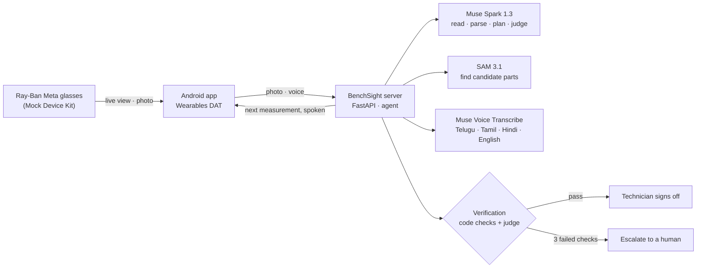
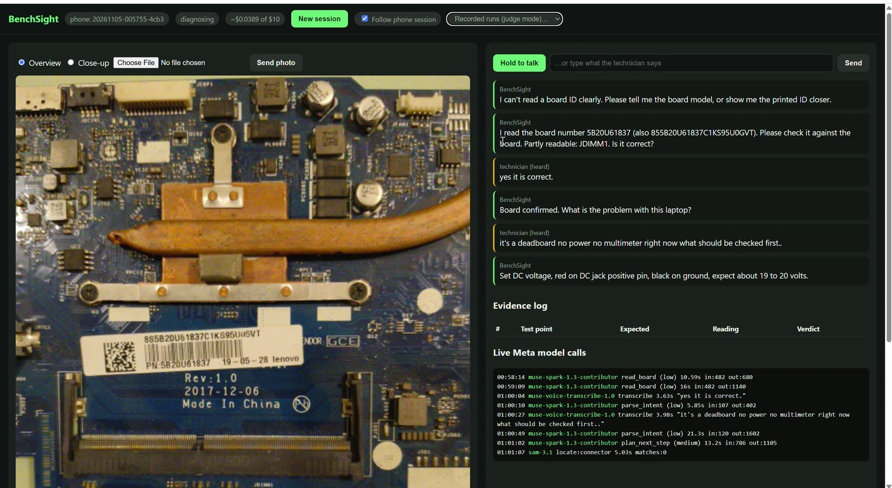
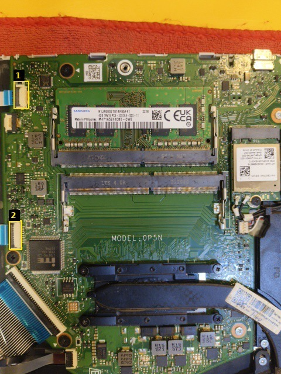

<p align="center">
  
</p>

<p align="center">
  
  
  
  
  
  
  
  
  
</p>

<p align="center">
  <b>The technician looks at the board. BenchSight reads it, listens in his language,<br>
  and tells him the next point to measure, one reading at a time, until the evidence finds the fault.</b>
</p>

<p align="center">
  <a href="https://youtu.be/-PQv8QDac6Y"></a><br>
  <sub>▶ <a href="https://youtu.be/-PQv8QDac6Y">Watch the 3-minute demo</a> · real screen recordings and real voices, no mock-ups</sub>
</p>

---

## Contents

[The problem](#the-problem) · [How it works](#how-it-works) · [Meta models](#how-metas-models-are-used) ·
[Verification](#why-it-is-reliable) · [Real tests](#real-tests) · [Run it](#run-it) · [Judge mode](#judge-mode-no-api-key-needed) ·
[Layout](#project-layout) · [Limitations](#limitations) · [License](#license)

## The problem

My family runs **Krishna Computers**, a computer sales and repair shop in Suryapet, Telangana, India.
In small shops like ours, a laptop board that needs one cheap part is often scrapped because the fault
can't be traced. There is no schematic, both hands hold multimeter probes, and the know-how to read a dead
board lives in a few experienced heads. Typing into a chatbot mid-repair isn't an option.

BenchSight puts that know-how in the technician's ear: hands-free, on Meta AI glasses, in Telugu, Tamil,
Hindi or English.

## How it works

<p align="center"></p>

1. **See.** The Android app opens a glasses session with Meta's Wearables Device Access Toolkit and shows the
   live camera feed. *Board* or *Close-up* captures a full-resolution photo. Muse Spark reads the board ID,
   maker, labels and visible damage. Partly readable text is flagged, never guessed, and the technician
   confirms the ID by voice.
2. **Listen.** Hold to talk. Muse Voice Transcribe turns speech into text; Muse Spark turns it into an intent:
   confirm, symptom, or a reading with value and unit.
3. **Guide.** Muse Spark plans **one measurement at a time**: meter mode, probe points, power state and the
   expected range. SAM 3.1 proposes candidate parts on the photo and Muse Spark picks the one that matches.
   Only then is a green **MEASURE HERE** box drawn; if nothing clearly matches, no box is drawn.
4. **Verify.** Readings are rated normal or abnormal in code. A proposed fault must pass code checks and a
   Muse Spark judge before the technician is asked to sign off.



Replies are spoken with the phone's or browser's built-in system voice (no AI model).

## How Meta's models are used

Every runtime model is a Meta model.

| Model | Where it runs | What it does |
|---|---|---|
| `muse-spark-1.3-contributor` | `server/vision.py`, `server/agent.py` | Reads the board (IDs, labels, visible damage); picks which SAM box matches a description; reads chip markings from full-resolution crops; parses what the technician said; plans the next measurement; judges any proposed conclusion. Structured JSON output with a chosen reasoning effort (low for live turns, medium for planning and judging). |
| `sam-3.1` | `server/vision.py` | Finds candidate parts ("connector", "capacitor", "chip") on the photo. Muse Spark chooses the right one from numbered boxes, or none. |
| `muse-voice-transcribe-1.0` | `server/models.py` | Push-to-talk speech to text with language bias for Telugu, Tamil, Hindi and English (code-switching) and keyword hints for repair terms. |
| Meta Wearables DAT 1.0.1 | `android/.../GlassesManager.kt` | Glasses session, live camera stream (live preview in the app) and full-resolution photo capture. The Mock Device Kit simulates Ray-Ban Meta glasses. |

Every model call is logged with model ID, purpose, latency, tokens and estimated cost in
`runs/<session>/trace.jsonl`, and shown live in the **Live Meta model calls** panel of the test bench.

<p align="center"><br>
<sub>The laptop test bench following a real phone session: conversation, evidence log and every Meta model call.</sub></p>

## Why it is reliable

Board repair is a niche, high-stakes domain, so the agent is not allowed to guess:

- **One measurement at a time**, each with meter mode, power state and an expected range. Readings are
  stored as evidence and rated normal or abnormal **in code**, not by the model.
- **Code checks** before any conclusion: it must cite recorded evidence IDs, at least one of them abnormal,
  with at least two measurements taken.
- **AI judge**: a separate Muse Spark call checks that the conclusion follows from the evidence alone.
- **Max 3 attempts**, then BenchSight escalates to the technician instead of guessing.
- **Human sign-off**: nothing is marked diagnosed until the technician says "confirm".
- **Board IDs are always confirmed** by the technician (vision misreads like S/5 and V/M were seen in testing).
- **No box rather than a wrong box**: SAM 3.1 proposes, Muse Spark must pick a match or answer "none".

<table>
<tr>
<td width="38%"></td>
<td>

**Two models check each other.** On the HP board in the shop test, SAM 3.1 proposed two "connectors" when
asked for the DC jack. Muse Spark looked at the numbered boxes and rejected both:

> *"Boxes 1 and 2 are small multi-pin FFC/wire-to-board connectors on left edge, not the larger DC power jack."*

So BenchSight drew no box and described the point in words instead. The image is the exact numbered
picture Muse Spark was given, re-drawn from the boxes in the session log.

</td>
</tr>
</table>

## Real tests

Both sessions are in `demo_runs/` and can be replayed without an API key.

| Session | Where | Board | What happened |
|---|---|---|---|
| `20261104-184725-e6b0` | A working repair shop, with a technician | HP, `MODEL 0P5N`, symptom "the display is not appearing" | Board ID read from the third photo and confirmed by voice. Asked for the DC jack (19–20 V). SAM 3.1 found 2 connectors; Muse Spark rejected both, so no box was drawn. The technician said *"19.5 volts at the jack, already checked, adapter is fine, laptop doesn't power on, skip the basics, what's next"*: logged as evidence #1, normal, and BenchSight moved on to the standby rail (capacitor leg below the MODEL 0P5N print, expect 3.0–3.5 V). **14 Meta calls, ≈ $0.053.** |
| `20261105-005755-4cb3` | My room, dead board, no multimeter | Lenovo, FRU `5B20U61837` | First photo too far: BenchSight said it couldn't read an ID instead of guessing. Close photo: read `5B20U61837` and flagged `JDIMM1` as partly readable; confirmed by voice. Symptom by voice ("dead board, no power") → first measurement: DC jack, DC voltage, adapter connected, expect 19–20 V. SAM 3.1 found no matching connector, so no box was drawn. Stopped there (no multimeter). **8 Meta calls, ≈ $0.026.** |

**Technician feedback.** The first steps are too basic for an experienced technician; he wants whole-board
fault finding. BenchSight already skips steps the technician says are done (seen in the shop session).
Deeper fault trees per board family are next.

**Not yet done:** a full session from a dead board to a confirmed repair. Both real sessions stop after the
first one or two measurements.

## Run it

### Server (Windows, macOS or Linux, Python 3.10+)

```bash
pip install -r requirements.txt
copy .env.example .env            # Windows (macOS/Linux: cp .env.example .env)
                                  # then put your Meta Model API key in .env
python -m uvicorn server.app:app --host 0.0.0.0 --port 8000
```

Open <http://localhost:8000> for the test bench: photo upload (Overview / Close-up), hold-to-talk or typed
input, the evidence log and the live Meta model calls. Tick **Follow phone session** to mirror the phone live.

### Judge mode (no API key needed)

Start the server the same way, without a key, and pick a session from **Recorded runs (judge mode)**.
Each run in `demo_runs/` holds the real photos, the conversation, the evidence log and the full trace of every
Meta model call (model, latency, tokens, cost). Voice clips are not committed. Without a key, live calls
return a clear "MODEL_API_KEY is not set" message instead of failing.

### Android app (Meta glasses client)

Open `android/` in Android Studio (Gradle JDK 21) and run it on an Android 12+ phone on the same Wi-Fi as the
server (allow port 8000 through the PC firewall). In the app:

1. **Server**: type the PC's IP (for example `192.168.1.10`; `http://` and `:8000` are added) → **Connect**.
2. **Glasses**: **Mock** (simulated Ray-Ban Meta), or **Ray-Ban Meta** for real glasses registered through the
   Meta AI app in Developer Mode (not tested: I don't own glasses).
3. **Camera** → **Start**: the glasses view shows the live feed.
4. **Start Repair** → **Board** for the whole board, **Close-up** for labels and chips.
5. Hold the mic button and speak. The reply is spoken, and the **Next measurement** card shows the point,
   meter mode, power state and expected range.

## Project layout

```text
server/      agent.py      diagnosis + verification
             vision.py     Muse Spark + SAM 3.1
             models.py     Meta API wrappers, retries, budget guard
             trace.py      log of every model call
             app.py        FastAPI server
             static/       test bench + judge mode
android/     GlassesManager (DAT + Mock Device Kit, live preview, photo capture),
             MainActivity (UI), VoiceRecorder, Speaker, BenchClient
tests/       day-1 smoke tests for each Meta model
demo_runs/   recorded real sessions for judges
docs/        images used in this README
```

## Built during the hackathon

Built for the Meta Global AI Developer Hackathon (Oct 26 – Nov 4, 2026). All code in this repository was
written during the event; there is no pre-existing project code. Third-party pieces, used as published:

- Meta Wearables Device Access Toolkit (`com.meta.wearable:mwdat-*` 1.0.1 from Maven Central), under the
  Meta Wearables Developer Terms.
- The standard Gradle wrapper files in `android/` (`gradlew`, `gradlew.bat`, `gradle/wrapper/`), Gradle's own
  Apache-2.0 files, copied from Meta's public DAT sample so the build uses the same Gradle version.
- Open-source libraries listed in `requirements.txt` and `android/gradle/libs.versions.toml`.

## Limitations

- Built and tested with Meta's Mock Device Kit (simulated Ray-Ban Meta, phone camera as the glasses camera);
  real glasses use the same code path plus registration through the Meta AI app, but were not tested.
- Latency: planning and intent calls took 6–34 s in real sessions, which is slow for a live bench.
- SAM 3.1 can find no match for generic nouns on cluttered boards; BenchSight then describes the point in
  words without a box.
- Small chip markings need close-ups; whole-board photos are used for board ID and layout only.
- Diagnosis quality depends on the technician's readings; BenchSight never invents readings.

## License

Released under the [MIT License](LICENSE). © 2026 Preetham Kukkadapu.

<p align="center"><sub>Built by Preetham Kukkadapu for the bench next door.</sub></p>
